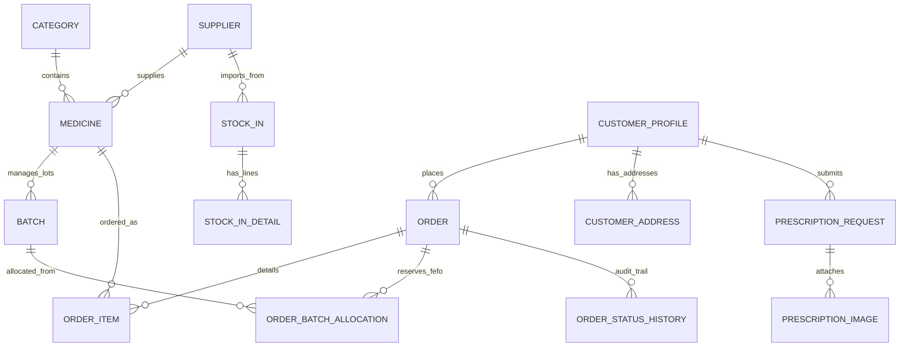
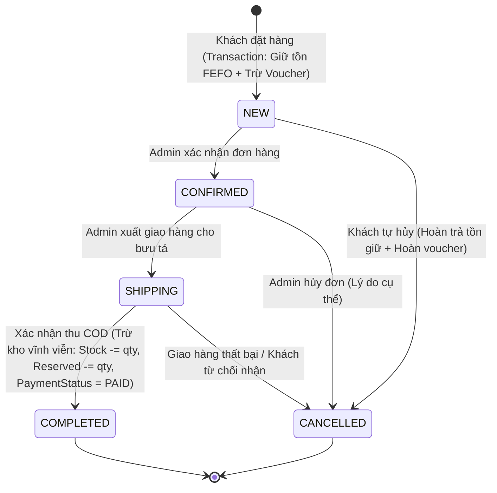

# KIẾN TRÚC HỆ THỐNG PHARMACY WEB (ARCHITECTURE & DATA LIFECYCLE)

## 1. Tổng quan Kiến trúc

Hệ thống được xây dựng trên nền tảng **ASP.NET Core MVC (.NET 8 LTS)** theo mô hình phân lớp rõ ràng, ưu tiên cấu trúc gọn gàng, dễ hiểu và dễ bảo trì cho sinh viên:

```text
E:/PharmacyStoreSolution/PharmacyWeb/
├── src/PharmacyWeb/
│   ├── Areas/
│   │   └── Admin/                 // Khu vực Quản trị dành cho vai trò Admin
│   │       ├── Controllers/       // 9 Controller quản trị (Dashboard, Products, Orders,...)
│   │       └── Views/             // Razor Views & Layout quản trị
│   ├── Controllers/               // Controller Storefront (Home, Products, Cart, Checkout,...)
│   ├── Data/
│   │   ├── Entities/              // 15 Entity C# ánh xạ CSDL
│   │   ├── Seed/DbInitializer.cs  // Bộ nạp dữ liệu mẫu thực tế tự động
│   │   └── PharmacyWebDbContext.cs// EF Core DbContext hỗ trợ SQL Server & SQLite
│   ├── Models/ViewModels/         // Lớp ViewModel có Data Annotations
│   ├── Services/                  // Tầng nghiệp vụ dùng chung giữa MVC và REST API
│   ├── Views/                     // Razor Views Storefront (Header, Footer, ProductCard,...)
│   └── wwwroot/                   // CSS Tokens, JS tương tác, hình ảnh
├── tests/PharmacyWeb.Tests/       // Bộ kiểm thử tự động xUnit (Unit & Integration Tests)
├── docs/                          // Toàn bộ tài liệu bàn giao bài tập lớn
└── README.md                      // Hướng dẫn cài đặt, cấu hình và chạy ứng dụng
```

---

## 2. Mô hình Dữ liệu (Database Schema)

Hệ thống sử dụng cơ sở dữ liệu riêng biệt **`PharmacyWebDB`**, hoàn toàn độc lập với database desktop `PharmacyStoreDB`:



### Các Thực thể Chính:
1. **`Medicine` & `Batch`:** Tách bạch rõ giữa thông tin thuốc và số lượng theo từng số lô cụ thể.
   - `TotalStock` (Tồn thực tế) = Tổng `Stock` của tất cả các lô.
   - `AvailableStock` (Tồn có thể bán) = Tổng `(Stock - ReservedQuantity)` của các lô chưa khóa (`IsBlocked = false`) và còn hạn (`ExpiryDate > Today`).
2. **`OrderBatchAllocation`:** Cầu nối giữ chỗ giữa Đơn hàng và Lô hàng theo thuật toán **FEFO (First Expired, First Out)**.
3. **`Voucher`:** Quản lý chiết khấu `FIXED` (tiền mặt) hoặc `PERCENT` (phần trăm có mức trần `MaxDiscountCap`), kiểm soát số lượng còn lại `Quantity`.

---

## 3. Vòng đời Đơn hàng, Tồn kho FEFO & Concurrency Control



### Nguyên tắc Nghiệp vụ Cốt lõi:
1. **Giỏ hàng Session:** Giỏ hàng của khách vãng lai lưu trong `HttpContext.Session`, không giữ chỗ trong kho.
2. **Khóa Idempotency khi Đặt hàng (`IdempotencyKey`):** Mỗi lần xác nhận đặt hàng, client gửi kèm một khóa GUID duy nhất. Nếu người dùng bấm nhanh 2 lần hoặc mạng chập chờn gửi lại POST request, hệ thống phát hiện khóa trùng và trả về ngay đơn hàng đã tạo trước đó mà **không tạo đơn mới, không giữ tồn trùng và không trừ thêm voucher**.
3. **Thuật toán Xuất kho FEFO trong Database Transaction:**
   - Khi tạo đơn, hệ thống tìm các lô của sản phẩm có `IsBlocked = false` và `ExpiryDate > Today`, sắp xếp theo `ExpiryDate ASC` rồi đến `Id ASC`.
   - Giữ số lượng trên từng lô: `Batch.ReservedQuantity += qtyAllocated`.
   - Ghi nhận chi tiết vào bảng `OrderBatchAllocation`.
4. **Xác nhận Thu tiền COD (`ConfirmPayment`):**
   - Khi đơn hàng hoàn tất và bưu tá giao tiền, thao tác Admin xác nhận thu tiền sẽ chuyển `PaymentStatus = "PAID"`, đồng thời thực thi:
     `Batch.Stock -= alloc.Quantity` và `Batch.ReservedQuantity -= alloc.Quantity`.
5. **Hủy đơn hàng:**
   - Hoàn lại lượng đã giữ: `Batch.ReservedQuantity -= alloc.Quantity`.
   - Nếu đơn có áp dụng voucher, hoàn lại lượt: `Voucher.Quantity += 1`.
6. **Kiểm soát Xung đột (`OrderVersion` Concurrency Token):** Mỗi lần cập nhật trạng thái đơn, `OrderVersion` tăng lên 1, bảo đảm hai nhân viên quản trị không vô tình ghi đè thao tác của nhau.

---

## 4. Tách biệt Khỏi Ứng dụng Desktop

1. **Cơ sở Dữ liệu Độc lập:** Website sử dụng cơ sở dữ liệu riêng `PharmacyWebDB` (SQL Server) hoặc SQLite local file `PharmacyWeb.db`, không can thiệp cơ sở dữ liệu `PharmacyStoreDB` của desktop.
2. **Tài khoản Người dùng:** Khách mua hàng đăng ký trên website được lưu tại bảng `CustomerProfiles` liên kết `AspNetUsers`, không dùng chung bảng `Employees` của nhân viên nội bộ desktop.
3. **Kế thừa Quy tắc:** Kế thừa chuẩn xác thuật toán FEFO, mã hóa màu sắc POS Teal/Mint, và cấu trúc snapshot giá tiền từ các phân tích nghiệp vụ của desktop.
